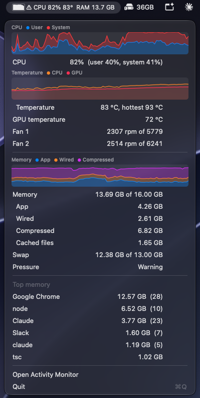

# MenuStats

<p align="center">
  
</p>

A small macOS menu bar app showing CPU, memory, temperature and fan usage. It's plain AppKit with no dependencies and no Xcode project, and it uses about 1% CPU and 25 MB of memory.

The menu bar shows a CPU graph, CPU usage, CPU temperature and memory used. The dropdown has:

- CPU, temperature and memory graphs covering the last 3 minutes
- CPU usage split into user and system
- CPU and GPU temperature, and fan speeds
- memory used, broken down the way Activity Monitor does it, with swap and memory pressure
- the apps using the most memory, with helper processes counted towards their app

## Build

Requires the Xcode command line tools.

```sh
./build.sh          # builds build/MenuStats.app
./build.sh install  # also copies it to /Applications and launches it
```

To start it at login, add it in System Settings → General → Login Items.

## Notes

- Temperatures and fan speeds come from the SMC (System Management Controller) and need no extra permissions. The sensor names it looks for are those used on M1 and M2 chips, so on other Macs the temperature rows may not appear.
- Memory used follows Activity Monitor (app + wired + compressed), so it reads lower than `top`, which also counts cached files.
- Per-app memory can only be read for your own processes, so apps running as other users are left out.
